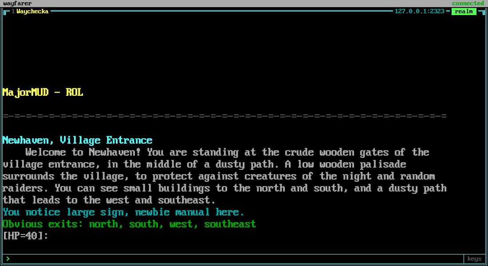

# The development rig (macOS laptop)

How to run the whole loop on one MacBook: the local silvermere, the gateway, the web UI and
card sessions in parallel worktrees. Nothing here runs on a schedule. The reasoning is in
[plan/07-development-and-testing.md](plan/07-development-and-testing.md).

Repositories sit side by side in `~/repos/`: `wayfarer`, `silvermere`, `silvermere-wayfarer`
(the server's run directory, below) and `mmud-exploration`.

## silvermere (the game server)

It is built from `~/repos/silvermere` and run from its own directory,
`~/repos/silvermere-wayfarer`, so that a `git pull` or rebuild never touches the world or the
characters. Its `silvermere.toml` there has:

```toml
[server]
telnet_bind = "127.0.0.1:2323"
admin_bind = "127.0.0.1:8080"
```

First time:

```sh
cd ~/repos/silvermere && cargo build --release
cd ~/repos/silvermere-wayfarer
~/repos/silvermere/target/release/silvermere import        # the built-in stock world
~/repos/silvermere/target/release/silvermere account create NAME --sysop
```

`account create` asks for the password on its own line. Make a few test accounts; they are what
`credentials.toml` (below) holds.

Run it in its own terminal tab:

```sh
cd ~/repos/silvermere-wayfarer && ~/repos/silvermere/target/release/silvermere serve
```

Ctrl-C saves everyone and stops it. It is long-lived: **client work never restarts it, and
cards never start, stop, rebuild or reset it.**

**Upgrading** is a deliberate act: stop it, `git pull` and `cargo build --release` in
`~/repos/silvermere`, start it again. **Backups**: `silvermere backup` from
`~/repos/silvermere-wayfarer` writes to `data/backups/`; take one before an upgrade.

## The gateway

```sh
scripts/dev/gateway.sh
```

builds `wayfarer` in release mode and runs `wayfarer gateway` with the config from your data
directory, `~/Library/Application Support/wayfarer/` (override with `WAYFARER_DATA_DIR`). The
first run copies [`examples/dev.toml`](../examples/dev.toml) there as `wayfarer.toml`; after
that the script never overwrites it. Edit the copy: change the placeholder characters to your
test characters, and put their accounts in `credentials.toml` beside it
([`examples/credentials.toml`](../examples/credentials.toml); the gateway creates it readable
only by you). The real config, credentials and logs stay in that directory, never in the
repository. See [gateway.md](gateway.md) for the file formats.

Extra arguments pass through: `scripts/dev/gateway.sh --bind 127.0.0.1:7374`. Ctrl-C (or
SIGTERM) logs every character off cleanly before the process exits.

## The UI

With the gateway running, the built UI is at `http://localhost:7373` (the gateway serves
`ui/dist`; build it with `npm run build` in `ui/`). For hot reload, run `npm run dev` in `ui/`
and open the address Vite prints; it talks to the gateway on 7373.

A tile with a test character in the realm, from `scripts/dev/gateway.sh` against the local
silvermere:



## Cards

```sh
scripts/dev/card.sh C-005
```

starts the card as a background Claude Code session (`claude --bg`) with the standard brief
from [plan/tasks/README.md](plan/tasks/README.md). The session makes its own git worktree under
`.claude/worktrees/`, works on `card/C-005-<slug>` and ends with a pull request against `main`;
it never merges. The session is named after the card (`C-005` in `claude agents`). Run the script from the main checkout. Running it again for a card that
already has a session does nothing.

| To | Command |
|---|---|
| list sessions | `claude agents` (`--json` for scripts) |
| watch one | `claude logs ID` (the short id `claude --bg` printed) |
| answer or steer one | `claude attach ID`, type, detach |
| stop one | `claude stop ID`; the conversation is kept and `claude attach ID` resumes it |

Two or three cards at a time: each is a full Rust build. The conductor session
(`/loop /conduct`) does the same dispatching for you.

## Permissions

`.claude/settings.json` pre-approves the routine commands so a background session does not
stall on a prompt nobody is there to answer: `cargo` build, test, fmt and clippy; read-only
`git` plus add, commit, push and worktree handling; `npm` scripts; `gh pr` create, view,
checks and comment; `scripts/live-check.sh`; and `claude --bg`, `agents` and `logs`. It
denies force-pushes and pushes to `main`, and **asks** before `gh pr merge`. The conductor
now merges on its own once CI is green and its review passes, and still waits for John on
anything marked "Needs John".

## Sleep

Closing the lid pauses everything: silvermere, the gateway, card sessions. On wake the
gateway's sessions reconnect and log on again through their logon scripts (C-005), and the
browser reconnects and asks for the output it missed by sequence number, so nothing is lost
from the scrollback. A card session carries on where it stopped; a CI wait simply resumes.

## What restarts when

| Part | Restarted when |
|---|---|
| silvermere | Never for client work; on purpose, to upgrade |
| Gateway | Only when its own code changes: Ctrl-C, run `scripts/dev/gateway.sh` again. Characters log off cleanly and back on |
| Brain | On every engine change, by a watcher (from M1); characters stay logged in |
| Web UI | On every UI change, by Vite's hot reload |

## Brain (from M1)

Not built yet. From M1 the brain runs under a file watcher in a third terminal tab, restarting
on every engine change while the gateway keeps the characters logged in. A script for it
joins `scripts/dev/` then.
