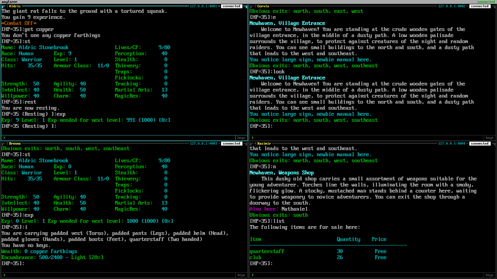
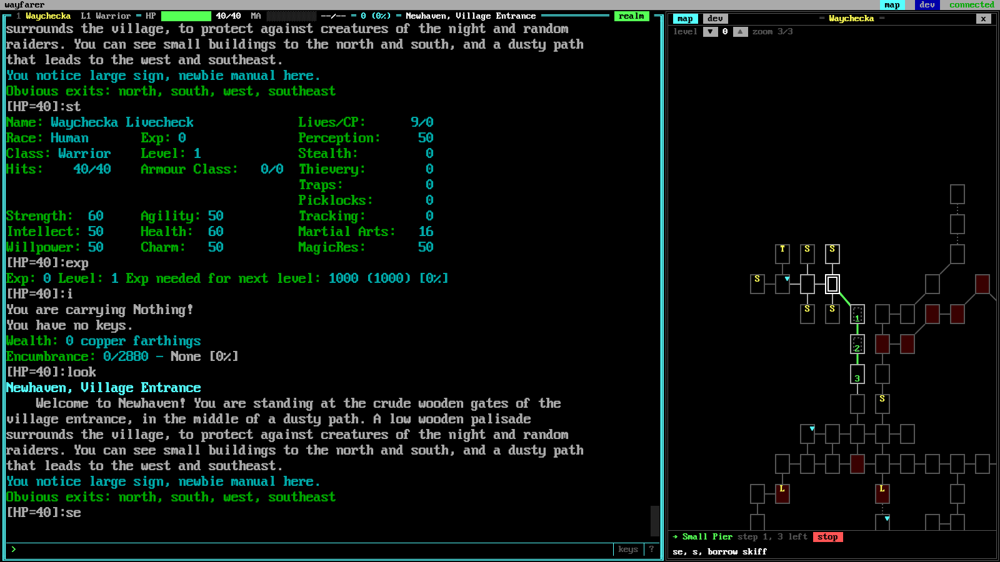
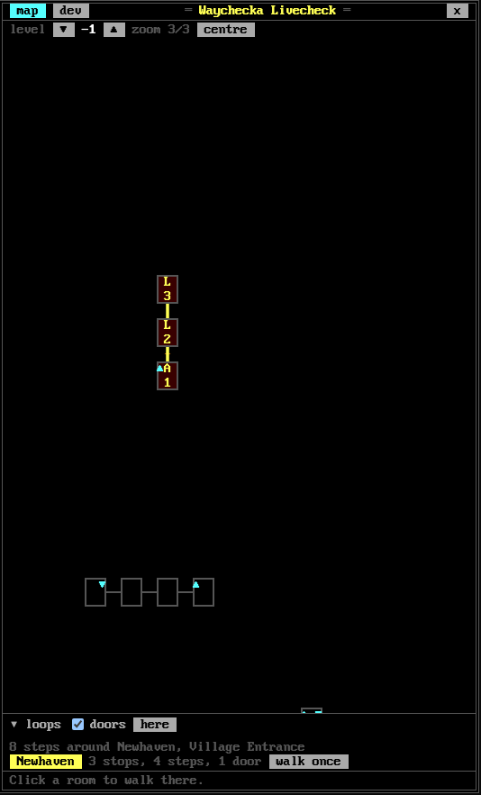
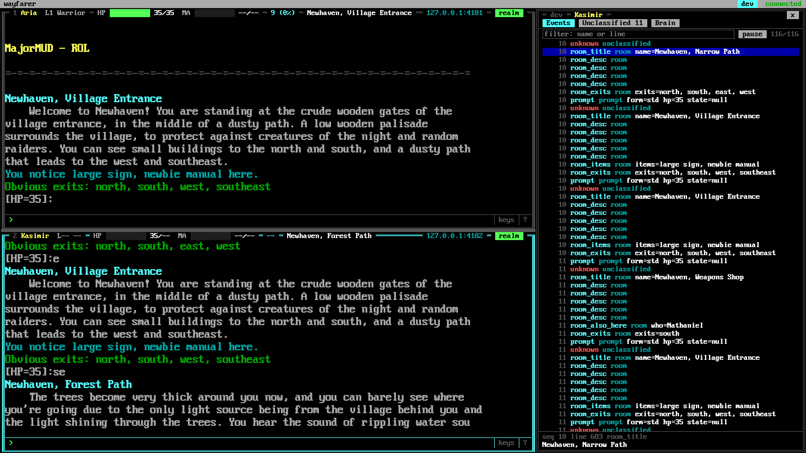

# The web UI

`wayfarer gateway` serves the web UI at its address (default `http://127.0.0.1:7373/`) once it
is built (`npm --prefix ui ci && npm --prefix ui run build`, which writes `ui/dist/`).



## Tiles

One tile per character in `wayfarer.toml`, laid out by count: 1; 1x2; 2x2; 2x3 or 3x2. Two
tiles always go side by side, one on the left and one on the right; five or six go side by
side or stacked, whichever makes the terminals larger on your screen. Each tile is framed in the font's double lines, with a header on the top line
(below).

## The header

```
╔═ 1 Waydeva  L3 Warrior ═ HP ███████░░░ 28/40  MA ░░░░░░░░░░ 0/0 ═ 1,230 (45%) ═════════════╗
║ Town Square                     Following Penny │ [║][■] │ 127.0.0.1:2323 │ realm [▬] [▼] ║
```

Two rows. The first, the frame's top: the tile's number (for `Alt+n`), the character's name,
then what the brain knows of them: level and class, HP and mana as bars with their numbers,
and exp with how far through the level it is. The second: the room's title on the left, and
on the right the party chip (see "The parties"), the bot's buttons, the server, the session's
state badge (`connecting`, `connected`, `logon`, `menu`, `realm`, `lost` or `closed`) and the
tile's own buttons.

- **Bars** are ten blocks: green above two thirds, yellow above one third, red below. HP and
  mana maxima come from the status screen, which the brain asks for when it re-syncs (the
  game's prompt has none), so until then a bar is empty and its maximum shows `--`.
- **Unknown values** show as `--`. Values update live as the brain reads the game; on leaving
  the realm (`x` to the menu) the last values stay and the badge changes.
- **Narrow tiles**: the first row drops items from the right, exp first, then mana, HP and the
  level, so the name always shows; the second row cuts the room title with `…` and drops the
  server before the room would get under 8 characters, so the badge and the buttons always
  show.
- **No brain**: without a brain attached the header is just the number and name, and under it
  the server and badge, with a dim `no brain` after the badge. The brain is `wayfarer brain` (`docs/brain.md`).
- A page that opens or reconnects while a brain is attached asks it for every character's
  state, so the headers fill at once.

Colours: the frame dark grey (light cyan on the focused tile), the name yellow, level, class
and labels light grey, numbers and the room white, exp light cyan, the server cyan.

The frame is drawn with the VGA font's own glyphs (`╔ ═ ╗` along the top, a column of `║` down
each side, `╚ ═ ╝` along the bottom) at the header's fixed 16 px, so the corners meet the
sides at every tile size and browser zoom. In the font's 8x16 cell `║` is two 2 px strokes in
columns 2-3 and 5-6, and `═` two 1 px strokes in rows 5 and 7. `node ui/scripts/frame-check.mjs
URL OUT_DIR` checks them against a running gateway at 90%, 100% and 125%.

The terminal is always 80 columns wide, in the IBM VGA 8x16 font and the 16 DOS colours. The
font is sized so the 80 columns fill the tile ("fit to tile"), and the terminal has as many
rows as fit below that. It keeps 10,000 lines of scrollback (mouse wheel), and when the page
opens it already shows the last 2,000 pieces of output from the gateway's log.

## The bot

With a brain that has a world pack, every tile's header carries that character's bot
controls, just left of the server:

```
╔═ 1 Waydeva  L1 Warrior ═ HP ██████░░░░ 22/35 ═ 1,230 (45%) ═ Newhaven, Arena ═ [║][■] ═ 127.0.0.1:2323 ═ realm ═╗
 Fight: large giant rat
```

The bot is **on or off**, and it may have a **route**: a loop it runs, or a Go to (a click on
the map, a row of the go box, a loop's `walk once`) it has not finished
([brain.md](brain.md) "The bot's states"). `║` and `►` turn it off and on and keep the route;
`■` drops the route and leaves it on or off as it was.

| State | Buttons | Line under the header |
|---|---|---|
| Off (every character to begin with) | `[►]` start | none |
| On, no route: it plays where it stands | `[║]` off | the narration, light cyan: "Fight: large giant rat", "Recover: resting to 85% in Newhaven, Narrow Road", "Waiting here" |
| On, with a route | `[║]` pause, `[■]` drop the route | the narration: "Loop Newhaven: to stop 2/3 Dungeon, Entrance", "Going to Newhaven, Arena" |
| Off, with a route (paused) | `[►]` go on with it, `[■]` drop it | yellow: "Paused: asked to pause" |

**Start** plays the character where it stands: it fights what comes, keeps auto-combat on,
rests when HP is low (in the nearest quiet room if this one spawns, then walks back), and
flees below 25% HP to a room where nothing spawns, rests there and walks back; when a monster
follows it through every room it turns and fights it ([brain.md](brain.md) "Flee"). **A Go
to or a loop** turns the bot on whatever it was: it fights on the way, and at the end of a Go
to it plays where it arrived. **`■`**, or `stop` under the map, ends the loop or Go to: a bot
that is on plays on where it is, one that is paused stays off. **`║`** with a route pauses it
(`►` goes on with it, re-syncing first); with none it turns the bot off. **Typing beside
it**: a line goes between the bot's commands and does not pause it (`gossip hi`, `st`, `rest`,
`a rat`); a move you type (`n`), or keys in the terminal, ends its loop or Go to, and it plays
on wherever you take the character ([brain.md](brain.md) "Typing beside the bot"). `F9` is
`║` and `►`; `F10` is `■` (with no route it turns the bot off, or on). Hovering the line shows
why the bot stopped or paused. The glyphs are the VGA font's own: code page 437 has `►` and `■`
but no pause sign, so pause is `[║]`.

## Keys

| Key | Does |
|---|---|
| `Enter` in a tile's input line | Sends the line (an empty line sends just Enter) |
| `Up`, `Down` in the input line | That tile's command history |
| `keys` button | Sends what you type in the terminal straight to the game, key by key; click it again to go back to the input line |
| `Alt+1` to `Alt+6` | Focus a tile (on a Mac, `Option`) |
| `Ctrl +`, `Ctrl -` | Make the focused tile's font larger or smaller |
| `Ctrl 0` | Back to "fit to tile" |
| Drag the line between two tiles | Gives one tile more room and the other less; remembered per browser |
| Double-click a line between tiles | Back to equal shares for that direction (columns or rows) |
| `Alt+0` | Back to equal shares for columns and rows (on a Mac, `Option`) |
| `?` on an empty input line, or the `?` button | Open or close this help |
| `Esc`, `?` again, or a click outside | Close this help |
| `Alt+M`, or the `map` button | Open the drawer on the map of the focused character's surroundings, or close it (on a Mac, `Option`) |
| Click a room on the map | Go there: the bot turns on, fights on the way and plays where it arrives; `stop` under the map ends the walk, as `[■]` |
| `Alt+G`, or the `go` button | Open the go box above the map: type part of the name of a room, a shop, bank or trainer, or a monster (two letters or more) and the list fills as you type (on a Mac, `Option`) |
| `Up`, `Down`, `Enter` in the go box | Choose a row (the map centres on its room when in view) and walk there; a boss lair's row has a ticked `stop short` box: the walk stops one room before it |
| `Esc` in the go box | Clear it; `Esc` again closes it |
| Mouse wheel, drag on the map | Zoom (three sizes), pan; `centre` goes back to the character |
| `loops`, beside `go` | The 12 loops nearest the character, nearest first, with a box to find one by name, file, author or a stop, however far: hover or pick one to draw it in yellow, `walk once` walks it, `run` hunts round it (untick a stop to pass it by) |
| `Alt+P`, or the `parties` button | Open the drawer on the parties: pick a leader, tick its followers, save; each member's state under it (on a Mac, `Option`) |
| The party chip in the tile's header | `★ Leading`, `Following` or `Separated`; click it to leave the party, or to join one |
| `Alt+B`, or the `blessings` button | Open the drawer on the blessings: tick the lasting spells each character keeps on itself (bless, barkskin, holy aura); ● marks one that is on (on a Mac, `Option`) |
| `F10`, or `[■]` in the tile's header | Drop the focused character's loop or Go to: it plays on where it is (paused, it stays off); with neither, turn the bot off, or on |
| `F9`, or `[║]` and `[►]` in the tile's header | Pause the focused character's loop or Go to and go on with it; with neither, turn the bot off and on where it stands (fight what comes, rest when low) |
| `Alt+S`, or the `stats` button | Open the drawer on the stats of the focused character's runs: exp per hour, kills, deaths and flees, now and for the last runs; or close it (on a Mac, `Option`) |
| `Alt+T`, or the `settings` button | Open the drawer on the focused character's settings (the form, "The settings" below), or close it (on a Mac, `Option`) |
| `Alt+D`, or the `dev` button | Open the drawer on the dev panel: the focused character's events, unclassified lines and the brain; or close it (on a Mac, `Option`) |

The `?` overlay shows these keys, what the state badges mean and where the data files live. It
is wayfarer's help only, never the game's; a `?` typed after other text on the line is sent to
the game as text. The table above and the overlay come from one table in `ui/src/lib/keys.ts`,
and a test fails when they differ.

Clicking a tile focuses it. The **keys** button sends what you type in the terminal itself
straight to the game, key by key, instead of a line at a time: for the character editor and
`Hit any key` prompts. Click it again to go back to the input line.

## Resizing tiles

Between two columns or two rows of tiles is a line about 6 px wide. Drag it to give one tile
more room; only the two tiles beside it change, and a drag stops when a tile would be narrower
than an 80-column terminal at the smallest font (6 px) or shorter than a few rows. Touch works
too. Double-click a line to put that direction back to equal shares; `Alt+0` does both.
Tiles refit their font as they change, still 80 columns wide.

The sizes are proportions, so resizing the window keeps them. They are kept per grid shape
(`1x2`, `2x2`, `2x3`, and so on, rows by columns) in the browser's `localStorage` under
`wayfarer.layout`, as `{"v": 1, "shapes": {"2x2": {"cols": [1.4, 0.6], "rows": [1, 1]}}}`;
adding or removing a character changes the shape, so that shape's own sizes apply. The layout
is per browser until settings arrive (`docs/plan/04-settings.md`); it is not written to
`wayfarer.toml`. With storage unavailable the layout still works and is forgotten on reload.

## The drawer

The map, the parties, the blessings, the stats, the settings and the dev panel share one
drawer on the right, a third of the window at most; the tiles refit beside it. Its tabs are
the six buttons on the bar at the top, `map`, `parties`, `blessings`, `stats`, `settings` and
`dev`, the open one lit, with the focused character's name before them while it is open; it
has no title row of its own. `Alt+M` (on a Mac, `Option+M`) or the `map`
button opens it on the map, and again closes it; `Alt+S` or the `stats` button and `Alt+D` or
the `dev` button do the same for the stats and the dev panel, and each key switches tabs when
the drawer is open on another. It follows the focused tile.
It is closed by default; whether it is open, its tab and the dev panel's own tab are kept in
the browser's `localStorage` under `wayfarer.dev`.

## The map

The rooms around the focused character, drawn the way the old mapper programs drew them:
each room a box, exits as lines between boxes, one level at a time. The brain lays the rooms
out and sends them (`map_view`, [protocol.md](protocol.md)); the panel draws what it is sent
and works nothing out itself.



- **Rooms**: a box of 3x2 character cells per room. The room the brain believes the
  character is in is bright white with a double frame. While the brain is not sure (several
  rooms fit what was seen) the other candidates are framed in yellow, and the tools line says
  how many there are; they collapse to one as the character moves. Rooms the character has
  certainly been in since the brain started are framed light grey, the rest dark grey. Rooms
  where monsters spawn are filled dim red. A letter marks the kind of room: `S` shop, `T`
  trainer, `B` bank, `A` arena, `L` lair. `▲` and `▼` in a box mean an exit up or down.
- **Exits**: a solid line for a plain exit, a gap with a brown `+` for a door (gates and key
  doors too), a dotted line for a hidden or text exit, and an arrow head at the far end of a
  one-way exit. A room whose place on the grid was already taken by another room is drawn
  there as a dashed frame inside the other one, without exits; hovering the cell names the
  room underneath first.
- **Levels**: one level at a time, the believed room's first. The `level` buttons show the
  floors above and below that are in the view.
- **Moving around**: the map centres on the believed room and follows it as the character
  moves. Drag to pan; once panned (or on another level) it stays where you put it, and a
  `centre` button brings it back. The mouse wheel zooms between three sizes (the VGA font at
  8, 12 and 16 px; 16 to start), about the pointer.
- **Where it is**: the upper right corner of the map shows the room the brain believes the
  character is in, `map:room` (`1:1217`), with `(1 of 2)` when it cannot tell which of two or more
  rooms it is (the lowest is shown). When it is lost the panel says "position unknown: re-sync or
  look" in place of the map.
- **Hover** a room for its name, `map:room` and kind, whether monsters spawn there, its exits
  in view (with their kind) and whether the character was there.
- **Walking**: click a room and the character walks there, confirming each step
  ([brain.md](brain.md), "Walking"). The route shows on the map as a green path with each
  room's step number, and in the bar under the map: the destination, the step in progress and
  the steps left, and the commands the walker will still type (`n, n, e, borrow skiff`), from
  the brain. A door shows on the map; the walker types `open` only when it finds the door
  closed, so that is not listed ahead. **stop** stops the walk
  after the move in flight. Clicking another room while walking replaces the walk. Two
  characters can walk at once; the panel shows the focused one.
- **Go to**: the map only shows its 15 steps, so for anywhere farther there is the **go**
  box (`Alt+G`, or the `go` button on the tools line). Type part of a name, two letters or
  more (`woo`, `chief`, `skali`), or a room by its number, `1:1217` (`1217` alone is a room on
  the character's own map; the hover on the map shows each room's `map:room`): the list under the box fills as you type, from the brain
  ([brain.md](brain.md), "Go to"), best first. It holds room names (`Wooden Passage, 63
  rooms, nearest 43 steps`; `▸` opens the group onto its nearest 20 rooms), well-known places
  (shops, banks and trainers by their room name, and MegaMud's named rooms when the world
  pack has them) and monsters with the rooms they spawn in (`minotaur chieftain, boss, lairs
  at Large Wooden Room 1:1865, 46 steps`). Distances are route lengths from the character;
  beyond 200 steps a room is `far`, and one the character has no way to is `no route`,
  listed last and not walkable. `Up` and `Down` choose a row, and the map centres on its room
  when the room is in view; `Enter` (or the row's **go** button, or a double-click) walks
  there as a click on the map does. A **boss lair**'s row (a room whose monster spawns one
  at a time, such as the Chieftain's) has a ticked **stop short** box: the walk stops in the
  room before the lair so you can look before going in, and the walk bar says `one room
  short of Large Wooden Room (boss: minotaur chieftain)`. Untick it to walk in. `Esc` clears
  the box; `Esc` again closes it.
- **Fight on the way**: the tick beside `go` on the tools line (ticked to start; the browser
  keeps it) is for every Go to, a click on the map and the go box alike, and every character.
  Unticked, the bot fights nothing until it arrives, not even what attacks it (it still flees
  under its flee line), and the walk bar says `not fighting on the way`. Changing it changes
  the Go tos already under way too (`journey_fight`): untick it mid-fight and the character
  walks on. Once there, the bot plays and fights as usual ([brain.md](brain.md) "Go to").
- **Connecting and logging off**: the tile's header has **[log off]** while the character is
  connected (logon, menu or realm) and **[connect]** when it is `closed` or `lost`. **log off**
  logs the character off cleanly, as the gateway does when it stops (the brain is told and stops
  the bot first), and the session stays closed, not reconnected, until **connect**; **connect**
  opens the connection and runs the logon again. After a hang-up (`health.hangup`,
  [brain.md](brain.md) "Flee") the tile shows `closed` the same way.
- **Minimizing a tile**: the `[▬]` button in a tile's header hides the tile to a bar at the bottom
  of the page, one chip per minimized character (`2 Waydeva 65/65 ►`: its number, name and HP, in
  the HP colours, or `closed` while it is not in the realm; `►` when the bot is playing it). The
  other tiles share the room. Click the chip, or press `Alt+n` for its number, to bring the tile
  back where it was (the tiles keep their order and numbers). A minimized character carries on:
  its terminal keeps receiving output and its bot keeps playing, so idle or following characters can
  be put away. The minimized set is kept in the browser. Minimizing the focused tile moves the focus
  to one still showing.
- **Errands**: the `[▼]` button in a tile's header (in the realm, with a brain attached) opens
  a menu: **Pick up all** (the coins and the items on the floor, copper included) and **Equip all**
  (wear and wield what is carried, into empty slots only; nothing worn is replaced), and
  **Train** (walk to the right trainer and train levels; it stays there so you can train stats),
  **Recover death pile** (walk to where the character last died, pick up and equip; greyed with no
  death on record), **Cancel errand** while one runs, and **Spell plan…**, which lists the spells the class could
  learn and the character lacks, each at its best shop with the price in coins, the steps there and
  a tick (`✓`) where the cash on hand still covers it, then what the cash buys now and what all of
  them cost; spells above the character's level are greyed ("needs level 9"). Under the plan,
  **buy spells** runs the shopping errand: it draws money from the Bank of Godfrey in Silvermere if
  the cash falls short, walks to the shops, buys what the money covers (the cheapest first) and
  reads the scrolls ([brain.md](brain.md) "Buying spells"); the `[x]` closes the plan. They are offered only while the bot is stopped or paused. The
  tile's narration line shows what the errand is doing, and a notice says what it did
  ([brain.md](brain.md) "Errands").
- **Recent places**: with nothing typed, the go box lists where the character died (its gear
  is in that room), fled from and was stopped in, newest first, ten at most, each with how long
  ago, the room's name and `map:room` (`died 12 m ago: Slum Street 1:1217`; a flee says from
  whom, a stop why). Pick a row (`Up` and `Down`) and press **go** or `Enter` to walk there. The
  brain keeps them, run or no run, and they survive a restart.
- **Loops**: `loops ▸`, beside `go` above the map, opens the list of the 12 loops nearest the
  character ([brain.md](brain.md), "Loops"), nearest first, each with its distance in steps
  (the green number on the left). Opening it asks the brain again, and while it is open it
  asks again a moment after the character moves on and stands still, so the nearest are
  always at the top. The box at the top **finds a loop**: every word you type must be
  somewhere in a loop's name, MegaMud file, description, author or the name of one of its
  stops (`keep courtyard`); the brain looks through all the loops the character can walk to,
  however far, and the list becomes the 12 nearest that match ("12 nearest of 41 matching
  ..."). Escape clears it. A door never leaves a loop out when the character can open it or
  bash it; only a door it can neither bash nor pick (a key it does not hold) does. The list mixes the
  loops generated over the hunt rooms, those of your own (marked "mine") and, when the
  world pack has MegaMud's paths, MegaMud's verified loops. Each loop is one line, its
  distance, its name and its buttons, with a smaller line under it (steps, stops and doors;
  for MegaMud's, the file first); a long name is cut short, and hovering the line shows all of
  it: the full description, file and author, the distance and the stops (arena and lair
  marked). Loops at the same distance come with what can run first, then the shorter, then by
  name. The list scrolls inside its own area, which takes at most about a third of the map,
  with the search box kept at the top. Hovering a loop draws it on the map in yellow with each stop's
  number; clicking its name keeps it drawn (click again to let it go). **walk once** walks a
  loop, generated or MegaMud's: to its nearest stop, round the others and back, a walk per stop, with the
  route and **stop** in the bar as for any walk; the dev panel has the stops as they come
  (`Loop stop 2/3: Dungeon, Entrance`).
  A MegaMud loop is listed by
  its description, with its file under it. Picking a loop shows the floor of its first stop: the Newhaven loop is down the
  stairs from the Narrow Road, the Arena and the two Lairs north of it.
- **Running a loop**: **run** beside a loop, generated or MegaMud's, makes the bot hunt round it
  ([brain.md](brain.md), "Running a loop"): it walks to the loop's nearest ticked stop, fights
  what is there, and goes on to the next, round and round with no respawn clock. **stops ▸** under a loop lists its stops, each with a tick (the list scrolls, and starts folded away); hover a stop for the
  monsters it spawns and how soon they come back after a kill; for a boss, whether it should be
  up ("minotaur chieftain should be up in 1 h 20 m", from this character's own kills). A MegaMud loop the brain says
  cannot run for this character has its **run** greyed out and the reason beside it ("nothing
  to hunt on it", or the leg no route takes and why). An unticked stop is passed by
  (the Minotaur Chieftain's room is the case for it). While the bot runs the loop, the list
  shows `▶ 2/3` in place of **run** and a green bar beside the row, the stop it is at or walking to is lit in the stops list, and the
  ticks are the bot's: a tick changed then goes to the bot at once. Pause and go on (`F9`)
  keep the loop; `■` (`F10`) drops it, and the bot plays where it is; the tile's narration says what it is doing
  ("Loop Newhaven: to stop 2/3 Dungeon, Entrance (one step, one door)", "Stop 1/3 cleared: 1
  large giant rat").

  
- **Your own loops**: with a loop picked, "Make a loop from X" takes a name and **save as my
  loop**, which keeps a copy of the loop's stops under that name; to change it first, find a room
  in the go box (`Alt+G`), press **add to loop** on its row, and give the number of the stop it
  goes after (empty: the end). Saved loops are listed under **My loops** with **walk once**,
  **run**, ticks on their stops like any loop, and **delete**. Saving the same name again
  replaces the loop. Example: pick Bandit Keep, find "leo", add Elaborate Bedroom after the
  last Living Quarters stop, save as "Hidden Keep with Leo the Quick", run ([brain.md](brain.md)
  "Custom loops").
- **Without a brain** the panel says so and draws nothing; with a brain but no known position
  (no world pack, or the room did not match) it says `position unknown: re-sync or look`.

The panel asks the brain for the view when it opens on a character, and again after a
reconnect or when the brain re-attaches; after that the brain sends a new one whenever the
believed room or the route changes. The view holds the rooms within 15 steps.

## The parties

The `parties` tab (`Alt+P`) lists every party the brain keeps ([brain.md](brain.md)
"Parties"). Each box is one party: its leader, picked from a list of the characters, and a
tick for each follower (five at most). A character already in another party says so beside
its name; ticking it moves it. Changing a box shows `save` and `undo`; `delete` asks again
(`really delete?`) before the party goes and its followers leave it in the game. `+ New
party` opens an empty box led by the first character in no party. The panel only edits the
parties: the brain forms them in the game when a leader and a follower with its bot running
are in one room. When one gets stuck (a follower shown joined that is not, or separated for
no reason), **re-sync** in its box, or **re-sync all** at the top, has every member check its
party with `par` at once and the invites and follows go again without waiting
(`party_resync`, [brain.md](brain.md) "Parties").

Under each follower is its state: `joined`, `not joined yet: forming up` (in the leader's
room) or `: in another room`, `away: its bot is not running` (or not in the realm),
`separated`, `walking to Penny (4 rooms)`, `resting 62%`, or `can't reach Penny: ...` with the
reason. After the state comes what the member is doing and its HP, from its bot's `doing`:
`joined · attacking large giant rat · 72%`, `· healing Lauren · 100%`, `· resting with the
party · 64%`, `· paused`. The leader's line, in the box's heading, shows what it is doing
while it is joined.

**The party chip.** A character in a party has a chip in its tile's header, beside the bot
buttons: `★ Leading: Lauren, Faye, Manuel` in yellow on the leader, `Following Penny` in cyan
on a follower, or `Separated` on yellow while a follower is out of the party in the game; its
title is the member's state. Click it for **Leave party** (a follower: it sends `leave` and
plays on its own). A character in the realm in no party has a dim `[party]` button instead,
whose menu offers **Join Penny's party** for each party with room.

**A follower's own walks are off.** Its errands stay on: those that walk (train, recover the
death pile, buy spells) say "Leaves Penny's party first", and do. In the map
panel, `go`, `walk once`, `run` and clicking a room are disabled, with "Following Penny: it
goes where the party goes"; the map says so above its tools. Its bot's play and pause work as
for any character.

## The blessings

The `blessings` tab (`Alt+B`) has a box for each character with the lasting spells it knows
that it can keep on itself or its party (from its `spells` screen: bless, barkskin, holy
aura), each with its word and mana. Tick the ones its bot keeps on and `save` (`undo` puts the
ticks back); `●` marks a spell that is on now. The brain keeps the ticks and casts the spells
between fights ([brain.md](brain.md) "Blessings"). A character whose spells have not been read
yet, or that knows none, says so.

## The stats

How the focused character's bot is doing, measured by the brain ([brain.md](brain.md)
"Statistics"). On top, the current run in large numbers: exp per hour (exp gained over the
wall time since Start), kills, deaths, flees, rests and the exp gained; a run lasts from Start
to Stop or a death, through pauses and brain restarts. Under them, a line of bars is the exp
over the newest run, a bar a minute. Then the last ten runs as rows, newest first: when each
started, its loop (`here` for "fight here"), minutes, exp per hour, kills, deaths and flees;
the run still going is in cyan. The rows come from the brain's store (`stats_request`): asked
for when the tab opens, when a run starts or ends, every minute while it is open, and on
`refresh`. **Reset**, beside "run since", ends the current run and starts a new one at zero
(`stats_reset` with `only: "run"`); the old run stays in the list and the combat numbers are
kept. It shows only while there is a run. "run since" says how long ago, too: the time since
the run started or was reset.

Under the run, **where the time went** ([brain.md](brain.md) "Where the time goes"): a bar
and a line for each kind, biggest first, with its share and its time: fighting, resting,
walking, waiting (for a monster, or the party), upkeep (looting, blessings, sneaking), fleeing,
paused and away. Then how efficient the run is: kills an hour of the bot playing (paused and
away left out), exp a minute of fighting, and per kill the time fighting, resting and between
kills (walking and waiting). A long time between kills says there are too few monsters where
it hunts; long rests say the fights cost too much. When the brain was not running for part of
the run, a line says how much of it was not seen.

Under the run, the **combat** numbers ([brain.md](brain.md) "Combat statistics"): since when
(the last reset, and how long ago), then swings, accuracy and crit rate, then a table in the
shape of MegaMud's Combat tab: `miss` (with the dodges), `hit`, `crit`, `bs` (with how many
of the backstab tries landed and how many crit), `cast` (its accuracy, and the failed casts),
`glance` and `round`, each with its count, its share of the swings, min-max and average
damage. Rows with nothing counted are left out. Last, killed, fled, and the lowest HP and mana
seen. They are kept across runs, stops and restarts until their own **Reset**, beside "combat
since" (`only: "combat"`; the run goes on): press it after changing weapons or settings,
starting a loop or a level-up.

Between the two, the **monster rules** the bot plays by ([brain.md](brain.md) "Monster
rules"): each rule (*flee from*, *never fight*, *avoid*), its pattern and where it comes from
(`default`, dim; `session`, learned from a stalemate; `player`). A player's rule has an `x` to
remove it; the line under the list adds one (`set_monster_rule`): pick the rule, type the
name, `add`. A pattern matches any monster whose name holds it, so use the full name (`ooze`
would also catch the glittering ooze). The settings page (M4) replaces this list.

## The settings

The focused character's settings as a form (`docs/plan/04-settings.md`), from the brain's
`settings` answer. Rows are grouped (Health, Combat, Spells, Coins, Movement, The bot), each
with its label, a control that fits it (a number box with its range, a switch, a list of
words), the unit, where the value in force comes from (`default`, `class & style`, `my
defaults`, `this server`, `this character`) and the setting's help line. The advanced
settings show with `all`.

- **Which file**: the buttons above the form choose the file being edited, `this character`
  (default), `this server` or `my defaults`; the line under them says which file that is and
  whether it exists yet. A control shows the value that file sets, or, where it sets none, the
  value in force; the badge says `set here` for the first and names the layer for the second.
- **Saving**: a change is sent as soon as the control changes (a number when its box loses
  focus or Enter is pressed). The brain checks it (range, words, the HP lines in order), writes
  the file, puts it in force at once (the tile says what changed) and answers with the new
  `settings`. A number outside its range is not sent and its box is marked; one the brain
  refuses (flee above the rest line) is explained by a warning and the form goes back to what
  is in force.
- **Reset**: a value the file sets has a `reset`, which takes it out of the file so the layer
  below shows through (the default, a preset, or another file).
- A change made to the file by hand shows up too: the brain sends the form again when it
  reloads a file.

## The dev panel

For development: what the brain sees. It is the drawer's `dev` tab (above).



- **Events**: the brain's parsed events for the character, newest at the bottom, each with
  the output `seq` it came from, its name, category and fields (`hp=28 maxhp=40`). The list
  follows new events until you scroll up. The filter box matches the name or the line's text;
  **pause** holds the list while events keep arriving (**resume** shows them). Click an event
  to see its whole line and line number.
- **Unclassified**: the lines the parser did not recognise (`unknown` events), grouped by
  text with their counts, most frequent first, and the unclassified rate: the snapshot's
  unclassified lines over lines parsed since the brain attached, as a percentage to two
  decimals, red above 0.2% (the soak metric, `docs/plan/03-engine.md`). **copy as KB notes**
  puts the list on the clipboard as a Markdown list (``- `line` (3x)``) for a PR's "KB notes".
- **Brain**: the brain's build, start time and world pack, whether it is attached, and a log:
  the brain attaching and leaving, each new start, `brain_lagged` (after which the page asks
  for every snapshot again), and the brain's notices and warnings with their character and
  time. **Re-sync** asks the brain to re-sync the focused character (`st`, `exp`, `i`, look);
  it is off with no brain attached.

The panel keeps the last 2,000 events and 500 notices per character, and up to 1,000
distinct unclassified lines, from when the page opened; a reload starts it empty.

## Connection

If the connection to the gateway drops (the gateway restarts, the network goes), every tile
says so and the page reconnects by itself, trying again after half a second and then less
often, up to every 10 seconds. Once back it fetches everything it missed, so nothing is lost or
shown twice. Reloading the page never logs a character off: the gateway holds the sessions.

If the gateway is reached over a non-loopback address it needs its token
(`docs/gateway.md`); the page asks for it once and remembers it in the browser.
